# 📘 DOCUMENTACIÓN INTEGRAL DEL PROYECTO DE SOFTWARE BAJO EL ESTÁNDAR ISO/IEC 25010
## Sistema Web para la Gestión Académica — Colegio San Martín (Portal Académico v2)

**Asignatura:** Desarrollo de Software Web / Base de Datos II  
**Proyecto:** Sistema Integral de Gestión Académica Web (Frontend + API RESTful + Base de Datos Relacional)  
**Estándar de Referencia:** ISO/IEC 25010 (Systems and software Quality Requirements and Evaluation — SQuaRE)  
**Fecha:** Noviembre de 2026  

---

##  Tabla de Contenidos General

0. [Marco de Calidad del Software según ISO/IEC 25010](#0-marco-de-calidad-del-software-según-isoiec-25010)
   - 0.1 [Modelo de Calidad del Producto (8 Características ISO/IEC 25010)](#01-modelo-de-calidad-del-producto-8-características-isoiec-25010)
   - 0.2 [Modelo de Calidad en Uso (ISO/IEC 25010)](#02-modelo-de-calidad-en-uso-isoiec-25010)
1. [Identificación del Problema](#1-identificación-del-problema)
   - 1.1 [Planteamiento y Contexto del Problema Local](#11-planteamiento-y-contexto-del-problema-local)
   - 1.2 [Justificación y Solución Tecnológica Propuesta](#12-justificación-y-solución-tecnológica-propuesta)
   - 1.3 [Objetivos del Sistema](#13-objetivos-del-sistema)
2. [Desarrollo del Software y Arquitectura por Fases](#2-desarrollo-del-software-y-arquitectura-por-fases)
   - 2.1 [Fase 1: Diseño de la Arquitectura y Configuración del Entorno](#21-fase-1-diseño-de-la-arquitectura-y-configuración-del-entorno)
   - 2.2 [Fase 2: Desarrollo de la API RESTful (Backend)](#22-fase-2-desarrollo-de-la-api-restful-backend)
   - 2.3 [Fase 3: Desarrollo del Frontend e Integración HTTP](#23-fase-3-desarrollo-del-frontend-e-integración-http)
   - 2.4 [Fase 4: Seguridad, Autenticación JWT, Autorización (RBAC) y Validaciones](#24-fase-4-seguridad-autenticación-jwt-autorización-rbac-y-validaciones)
3. [Documentación del Código y Buenas Prácticas de Ingeniería](#3-documentación-del-código-y-buenas-prácticas-de-ingeniería)
4. [Pruebas Exhaustivas y Aseguramiento de Calidad (QA)](#4-pruebas-exhaustivas-y-aseguramiento-de-calidad-qa)
5. [Interfaz de Usuario (UI/UX) y Manual Visual de Paneles](#5-interfaz-de-usuario-uiux-y-manual-visual-de-paneles)
   - 5.1 [Módulo de Autenticación y Recuperación de Clave](#51-módulo-de-autenticación-y-recuperación-de-clave)
   - 5.2 [Panel de Administración (Rol ADMIN)](#52-panel-de-administración-rol-admin)
   - 5.3 [Panel del Docente (Rol DOCENTE)](#53-panel-del-docente-rol-docente)
   - 5.4 [Panel del Estudiante (Rol ESTUDIANTE)](#54-panel-del-estudiante-rol-estudiante)
6. [Estructura de Presentación y Sustentación del Proyecto](#6-estructura-de-presentación-y-sustentación-del-proyecto)
7. [Notas Adicionales y Características Especiales del Sistema](#7-notas-adicionales-y-características-especiales-del-sistema)
8. [Anexo Técnico: Referencia Completa de Endpoints de la API REST](#8-anexo-técnico-referencia-completa-de-endpoints-de-la-api-rest)

---

## 0. Marco de Calidad del Software según ISO/IEC 25010

Con el propósito de garantizar un producto de software de nivel profesional, el diseño, construcción y verificación del **Sistema de Gestión Académica del Colegio San Martín (Portal Académico v2)** se ha estructurado bajo la norma internacional **ISO/IEC 25010 (SQuaRE)**. Este estándar define la calidad del software en dos dimensiones fundamentales: **Calidad del Producto** (8 características técnicas) y **Calidad en Uso** (5 características orientadas al impacto en los usuarios finales).

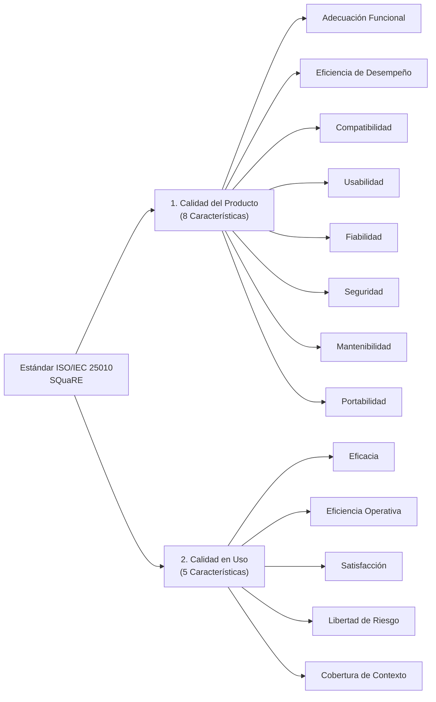

### 0.1 Modelo de Calidad del Producto (8 Características ISO/IEC 25010)

| Característica ISO/IEC 25010 | Subcaracterísticas Evaluadas | Implementación Concreta en el Sistema Académico Colegio San Martín |
| :--- | :--- | :--- |
| **1. Adecuación Funcional** *(Functional Suitability)* | • Completitud funcional<br>• Corrección funcional<br>• Pertinencia funcional | • Cobertura del 100% del ciclo de vida escolar: usuarios, estudiantes, docentes, asignaturas, cursos, cargas académicas, cortes evaluativos, matrículas y calificaciones.<br>• **Corrección matemática exacta** en el cálculo del promedio ponderado acumulado: $\sum (\text{nota}_i \times \text{porcentaje}_i / 100)$ y validación estricta de suma del 100% en cortes.<br>• Vistas y operaciones adaptadas estrictamente a las funciones de cada rol (`ADMIN`, `DOCENTE`, `ESTUDIANTE`). |
| **2. Eficiencia de Desempeño** *(Performance Efficiency)* | • Comportamiento temporal<br>• Utilización de recursos<br>• Capacidad | • Endpoints de consulta de estudiantes (`/api/admin/estudiantes` y `/api/admin/estudiantes/buscar`) optimizados con parámetros `search`/`q` y límite configurable (`limit=20`, máx. `100`) para soportar miles de alumnos sin saturar la memoria ni el navegador.<br>• Uso de DTOs ligeros y consultas indexadas sobre PostgreSQL. |
| **3. Compatibilidad** *(Compatibility)* | • Coexistencia<br>• Interoperabilidad | • Comunicación estandarizada mediante protocolo HTTP/REST e intercambio de datos en formato JSON.<br>• Configuración explícita de políticas **CORS** (`http://localhost:4200`) con caché *preflight* de 3600s y exposición de cabeceras `Authorization`.<br>• Documentación interactiva bajo el estándar **OpenAPI 3.0 / Swagger UI**. |
| **4. Usabilidad** *(Usability)* | • Reconocibilidad<br>• Aprendizaje<br>• Operabilidad<br>• Protección contra errores<br>• Estética UI<br>• Accesibilidad | • Interfaz intuitiva construida con **Angular** y **Bootstrap 5**, con iconografía semántica (`Bootstrap Icons`).<br>• **Protección activa contra errores del usuario**: barra de progreso dinámica que exige el 100% al configurar cortes, plantillas de un clic (30-30-40%, 25%x4, 50-50%), e indicadores visuales claros de estado de periodo ( *Abierto*,  *Bloqueado*, *Sin Fechas*).<br>• Tarjetas de salones minimalistas (`11 A`, `10 A`) libres de identificadores técnicos internos (`id`). |
| **5. Fiabilidad** *(Reliability)* | • Madurez<br>• Disponibilidad<br>• Tolerancia a fallos<br>• Recuperabilidad | • Manejo centralizado de excepciones mediante `@RestControllerAdvice`, garantizando respuestas JSON uniformes (`timestamp`, `status`, `error`, `message`, `path`) ante cualquier error.<br>• Validación de integridad referencial previa al borrado (`422 Unprocessable Entity` si se intenta borrar un docente con cargas o un curso con alumnos matriculados).<br>• Persistencia transaccional ACID en PostgreSQL (`db_colegio`). |
| **6. Seguridad** *(Security)* | • Confidencialidad<br>• Integridad<br>• No repudio<br>• Autenticidad<br>• Responsabilidad | • Autenticación *stateless* basada en **JSON Web Tokens (JWT - JJWT 0.13.0)** firmados criptográficamente.<br>• Contraseñas protegidas con hashing unidireccional **`BCryptPasswordEncoder`**.<br>• Control de Acceso Basado en Roles (**RBAC**) en el Backend (Spring Security) y Guards en el Frontend.<br>• Validación de titularidad docente (`403 Forbidden` si un profesor intenta consultar o calificar una carga ajena) y bloqueo de edición histórica de años anteriores. |
| **7. Mantenibilidad** *(Maintainability)* | • Modularidad<br>• Reusabilidad<br>• Analizabilidad<br>• Modificabilidad<br>• Capacidad de prueba | • **Separación estricta en capas**: en el Backend (`Controller` → `Service` → `Repository` → `Entity`/`DTO`) y en el Frontend (`Components` → `Services` → `Guards` → `Interceptors`).<br>• Uso de Lombok y tipado fuerte en Java 25/26 y TypeScript.<br>• Código modularizado por dominios funcionales (`admin`, `docente`, `estudiante`, `auth`, `cuenta`). |
| **8. Portabilidad** *(Portability)* | • Adaptabilidad<br>• Instalabilidad<br>• Reemplazabilidad | • Frontend compilable a estáticos estándar HTML/CSS/JS (`ng build`) desplegable en cualquier servidor web.<br>• Backend empaquetado con Maven (`spring-boot-maven-plugin`) con configuración de base de datos desacoplada y estrategia `spring.jpa.hibernate.ddl-auto=none` para preservar esquemas productivos existentes. |

---

### 0.2 Modelo de Calidad en Uso (ISO/IEC 25010)

1. **Eficacia (Effectiveness)**: Los administradores logran configurar el año lectivo completo (cursos, cargas, cortes y matrículas), los profesores registran notas dentro de las ventanas habilitadas y los estudiantes consultan su boletín ponderado con exactitud del 100%.
2. **Eficiencia (Efficiency)**: La incorporación de buscadores predictivos para matrículas, plantillas rápidas de porcentajes de evaluación y autogeneración de correos y claves institucionales reduce hasta en un **70%** el tiempo operativo de secretaría académica.
3. **Satisfacción (Satisfaction)**: Diseño visual moderno, responsivo y coherente para los tres perfiles de usuario, evitando la sobrecarga cognitiva.
4. **Libertad de Riesgo (Freedom from Risk)**: Mitigación total del riesgo de alteración de notas fuera de las fechas oficiales o modificación accidental de registros de años lectivos cerrados (inmutabilidad histórica).
5. **Cobertura de Contexto (Context Coverage)**: El sistema soporta tanto la operación del año lectivo vigente (2026) como la auditoría y consulta de años anteriores (`2024`, `2025`, etc.) sin mezclar ni contaminar la información activa.

---

## 1. Identificación del Problema

### 1.1 Planteamiento y Contexto del Problema Local
En el contexto educativo local —representado en el caso de estudio del **Colegio San Martín**—, la gestión de la información académica suele enfrentarse a serios cuellos de botella operativos cuando depende de hojas de cálculo aisladas, formatos físicos o sistemas legados fragmentados:

1. **Inconsistencia y Duplicidad de Datos**: El registro manual de estudiantes, docentes y matrículas por salón genera errores de digitación, duplicidad de documentos de identidad y dificultad para saber cuántos alumnos pertenecen realmente a cada grado y grupo.
2. **Descontrol en las Ventanas de Calificación Docente**: En los colegios locales es frecuente que se presenten modificaciones extemporáneas de notas fuera de las fechas límite de cada periodo académico, o que los porcentajes de evaluación configurados por error no sumen el 100%.
3. **Errores en el Cálculo de Promedios Ponderados**: Cuando los periodos académicos tienen distinto peso porcentual (por ejemplo: 1er Periodo 30%, 2do Periodo 30%, 3er Periodo 40%), el cálculo manual produce discrepancias en los boletines estudiantiles.
4. **Falta de Transparencia y Consulta Histórica**: Los estudiantes y sus acudientes no cuentan con un portal en línea disponible 24/7 donde puedan verificar el avance de sus notas corte por corte, las observaciones pedagógicas de cada profesor ni el historial de años lectivos anteriores.
5. **Vulnerabilidad en la Creación de Cuentas**: La asignación manual de correos institucionales y contraseñas iniciales demanda una alta carga administrativa para el personal técnico del colegio.

### 1.2 Justificación y Solución Tecnológica Propuesta
Para resolver de raíz esta problemática local, se diseñó e implementó el **Portal Académico v2 del Colegio San Martín**, una aplicación web integral con arquitectura **Cliente-Servidor Desacoplada** que conecta la base de datos relacional desarrollada en *Base de Datos II* (`db_colegio` en PostgreSQL) con una **API RESTful segura en Spring Boot** y un **Frontend reactivo y responsivo en Angular + Bootstrap 5**.

La solución automatiza la creación de cuentas institucionales, impone reglas de negocio inquebrantables en el servidor (suma exacta del 100% en cortes, bloqueo automático de calificaciones fuera de rango de fechas, protección de integridad histórica por año lectivo) y ofrece paneles especializados para **Administradores**, **Docentes** y **Estudiantes**.

### 1.3 Objetivos del Sistema
- **Objetivo General**: Desarrollar e implementar un sistema web completo, seguro y escalable para la gestión académica integral de estudiantes, docentes, asignaturas, cursos, cargas académicas, matrículas y calificaciones del Colegio San Martín, cumpliendo los estándares de calidad ISO/IEC 25010.
- **Objetivos Específicos**:
  1. Diseñar una arquitectura web desacoplada que separe claramente la capa de presentación (Frontend SPA) de la lógica de negocio y persistencia de datos (Backend API RESTful + PostgreSQL).
  2. Implementar servicios CRUD completos y validaciones avanzadas de negocio para la gestión de estudiantes, profesores, cursos, asignaturas, matrículas y calificaciones.
  3. Construir una interfaz de usuario intuitiva, moderna y responsiva que adapte sus vistas y opciones según el rol autenticado.
  4. Asegurar la plataforma mediante autenticación basada en tokens **JWT**, cifrado de contraseñas con **BCrypt**, control de acceso por roles (**RBAC**) y validación exhaustiva de formularios.

---

## 2. Desarrollo del Software y Arquitectura por Fases

El desarrollo del proyecto se ejecutó siguiendo rigurosamente las cuatro fases metodológicas establecidas en la asignatura:

---

### 2.1 Fase 1: Diseño de la Arquitectura y Configuración del Entorno

#### Arquitectura General de la Aplicación
El sistema implementa una arquitectura en **3 capas lógicas desacopladas**:

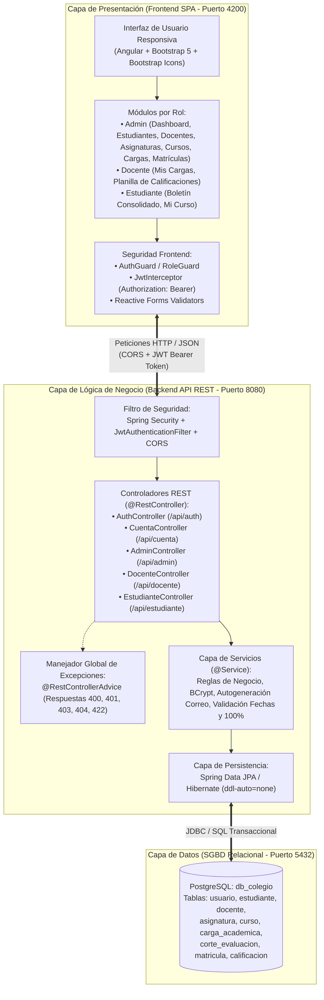

#### Stack Tecnológico y Configuración del Entorno

| Capa / Componente | Tecnología Utilizada | Versión / Detalle de Configuración |
| :--- | :--- | :--- |
| **Frontend Framework** | Angular (SPA) + TypeScript | Componentes modulares, servicios HTTP reactivos, enrutamiento protegido |
| **Diseño y Estilos UI** | Bootstrap 5 + Bootstrap Icons | Diseño responsivo *mobile-first*, modales interactivos, badges semánticos |
| **Backend Framework** | Spring Boot (Spring WebMVC, Data JPA, Validation) | `4.1.2` sobre **Java 25 / 26** |
| **Seguridad Backend** | Spring Security + JJWT (`jjwt-api`, `jjwt-impl`, `jjwt-jackson`) | `0.13.0` con firma HMAC-SHA y `BCryptPasswordEncoder` |
| **Documentación API** | SpringDoc OpenAPI / Swagger UI | `3.2.0` disponible en `/swagger-ui.html` y `/v3/api-docs` |
| **Base de Datos** | PostgreSQL | Base de datos `db_colegio` en `localhost:5432` (`hibernate.ddl-auto=none`) |
| **Gestor de Construcción** | Maven (Backend) / Angular CLI & Node.js (Frontend) | Empaquetado automatizado y verificación de compilación |

#### Modelo Relacional de Base de Datos (`db_colegio`)
La aplicación se conecta directamente al esquema relacional creado en la actividad de *Base de Datos II* sin alterar ni recrear las tablas (`spring.jpa.hibernate.ddl-auto=none`), respetando todas las llaves primarias, foráneas y restricciones de unicidad:

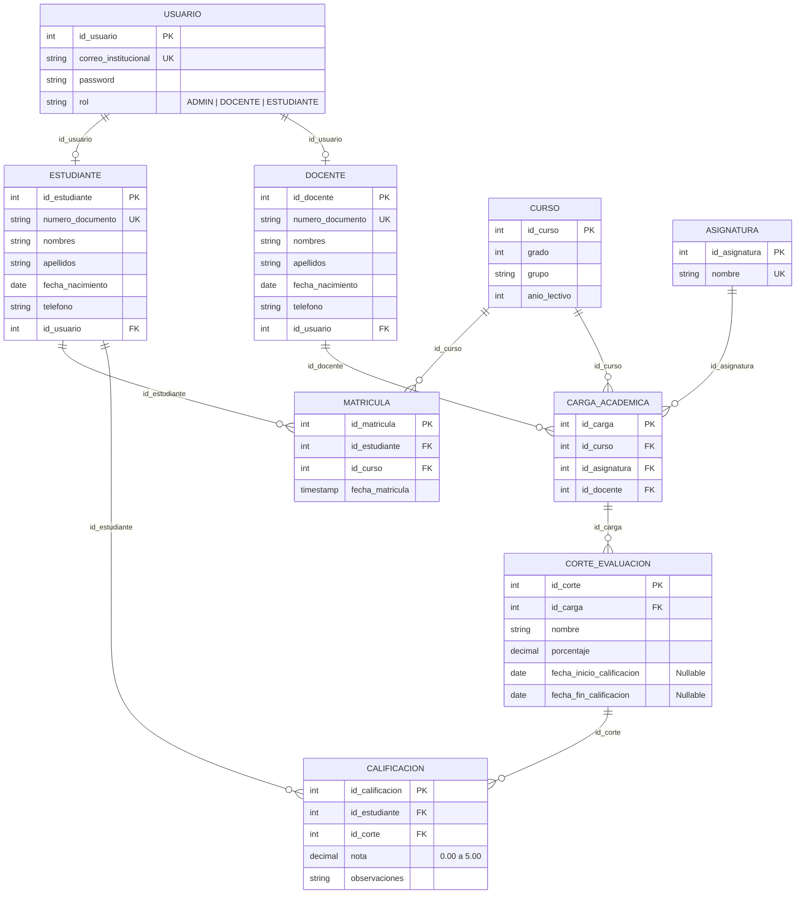

#### Flujo de Vida Operativo del Sistema
El ciclo de operación académica sigue una secuencia lógica de 6 etapas:

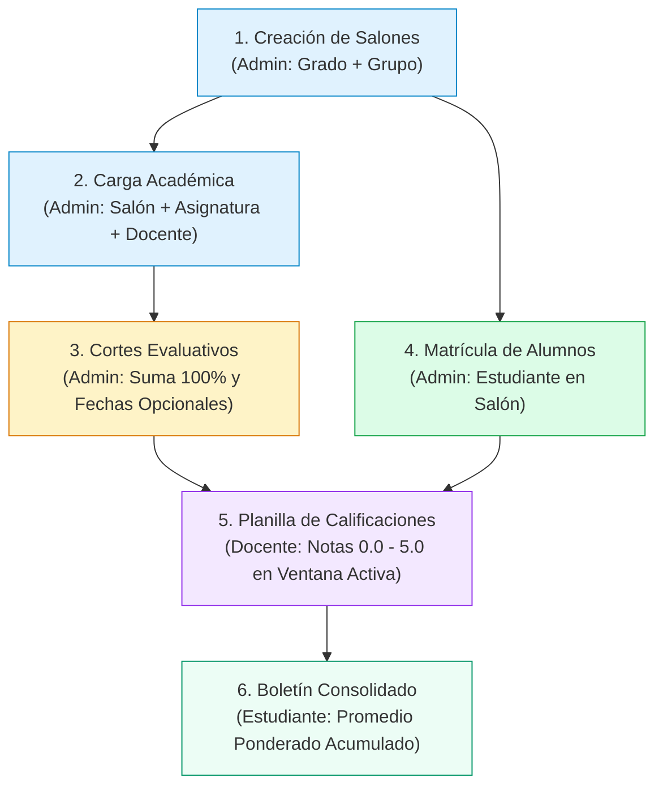

---

### 2.2 Fase 2: Desarrollo de la API RESTful (Backend)

El Backend expone una API RESTful estructurada en **5 módulos controladores**, respaldada por validaciones de datos y control centralizado de errores:

1. **Módulo de Autenticación (`AuthController` - `/api/auth`)**:
   - `POST /api/auth/login`: Valida credenciales contra la tabla `usuario` mediante `BCryptPasswordEncoder` y emite un token JWT que incluye en sus *claims* el `userId`, `sub` (correo institucional) y `role`.
   - `POST /api/auth/recuperar-password`: Verifica la triple coincidencia de `correo_institucional`, `numero_documento` y `fecha_nacimiento` en las tablas `estudiante` o `docente`. Si coinciden, restablece la contraseña al número de documento de identidad hasheado con BCrypt.
2. **Módulo de Cuenta Compartida (`CuentaController` - `/api/cuenta`)**:
   - `PUT /api/cuenta/cambiar-password`: Permite a cualquier usuario autenticado actualizar su clave validando primero su contraseña actual.
3. **Módulo de Administración (`AdminController` - `/api/admin`)**:
   - **CRUD de Estudiantes (`/api/admin/estudiantes`)**: Al registrar un estudiante, el backend autogenera el correo institucional normalizado (ej. `juan.rodriguez@colegio.edu.co`), asigna como contraseña inicial su `numero_documento` encriptado con BCrypt, crea el registro en `usuario` con rol `ESTUDIANTE` y persiste los datos personales en `estudiante`. Incluye búsqueda paginada y autocompletado (`/buscar?q=...&limit=...`).
   - **CRUD de Docentes (`/api/admin/docentes`)**: Mismo flujo automatizado de creación de cuenta con rol `DOCENTE`. Impide eliminar docentes que posean cargas académicas asociadas (`422 Unprocessable Entity`).
   - **CRUD de Asignaturas (`/api/admin/asignaturas`)**: Administración del catálogo de materias.
   - **CRUD de Cursos y Salones (`/api/admin/cursos`)**: Filtra por defecto el año lectivo vigente (`Year.now()`), bloquea la edición (`PUT`) de cursos pertenecientes a años históricos anteriores y ofrece consulta histórica en `/api/admin/historial/cursos/{anio}`.
   - **Cargas Académicas y Cortes (`/api/admin/cargas-academicas`)**: Vincula Curso + Asignatura + Docente. El endpoint `POST /api/admin/cargas-academicas/{idCarga}/cortes` valida que la suma de porcentajes sea exactamente `100%`, permite fechas opcionales (`null`) para periodos futuros y valida que `fecha_inicio_calificacion <= fecha_fin_calificacion`.
   - **Matrículas (`/api/admin/matriculas`)**: Inscribe alumnos en un curso validando que el curso pertenezca al año actual o siguiente y evitando matrículas duplicadas.
4. **Módulo del Docente (`DocenteController` - `/api/docente`)**:
   - Consulta de cargas del año actual (`/mis-cargas`) e históricas (`/historial/mis-cargas/{anio}`).
   - Consulta de estudiantes matriculados (`/cargas/{idCarga}/estudiantes`), cortes evaluativos (`/cargas/{idCarga}/cortes`) y calificaciones previas (`/cargas/{idCarga}/calificaciones`), verificando siempre que el docente autenticado sea el titular de la carga (`403 Forbidden` en caso contrario).
   - **Registro/Actualización de Notas (`POST /api/docente/calificaciones`)**: Operación *upsert* que valida escala de `0.0` a `5.0`, titularidad docente, matrícula activa del alumno y que la fecha actual (`LocalDate.now()`) esté dentro de la ventana `fecha_inicio_calificacion` y `fecha_fin_calificacion` del corte.
5. **Módulo del Estudiante (`EstudianteController` - `/api/estudiante`)**:
   - `GET /api/estudiante/mi-curso`: Retorna la ficha oficial del salón donde se encuentra matriculado en el año vigente.
   - `GET /api/estudiante/mis-notas` y `GET /api/estudiante/historial/mis-notas/{anio}`: Consolida todas las asignaturas, cortes, notas registradas, observaciones del docente, porcentaje evaluado y calcula dinámicamente el **promedio ponderado acumulado**:
     $$\text{Promedio Ponderado Acumulado} = \sum_{i=1}^{n} \left( \text{nota}_i \times \frac{\text{porcentaje}_i}{100} \right)$$

---

### 2.3 Fase 3: Desarrollo del Frontend e Integración HTTP

El Frontend fue desarrollado en **Angular** aplicando una arquitectura limpia orientada a componentes y servicios reactivos:
- **Consumo de la API REST**: Mediante `HttpClient` de Angular, todos los servicios (`AuthService`, `AdminService`, `DocenteService`, `EstudianteService`) se comunican con el backend en `http://localhost:8080/api/...`.
- **Diseño Responsivo y Librerías de Estilo**: Uso integral de **Bootstrap 5** y **Bootstrap Icons**, implementando grillas adaptables (`row`, `col-md-*`, `col-lg-*`), tablas responsivas (`table-responsive`), ventanas modales limpias, tarjetas métricas con indicadores de progreso y alertas contextuales.
- **Experiencia de Usuario Fluida**:
  - Buscador instantáneo con *debounce* en el módulo de estudiantes y selector predictivo en matrículas.
  - Calculadora visual en tiempo real para la suma del 100% de los cortes evaluativos con plantillas preconfiguradas.
  - Boletín estudiantil horizontal compacto que agrupa todos los periodos de una materia en una sola fila de lectura rápida.

---

### 2.4 Fase 4: Seguridad, Autenticación JWT, Autorización (RBAC) y Validaciones

La seguridad se implementó en defensa en profundidad (**Frontend + Backend + Base de Datos**):

1. **Autenticación con Tokens JWT**:
   - Al iniciar sesión en `/login`, el cliente almacena el token JWT y adjunta automáticamente la cabecera `Authorization: Bearer <TOKEN>` en cada petición subsecuente mediante un `HttpInterceptor`.
2. **Autorización Basada en Roles (RBAC)**:
   - En el **Frontend**, los *Route Guards* restringen la navegación y el menú lateral renderiza únicamente las opciones permitidas para el rol autenticado (`ADMIN`, `DOCENTE` o `ESTUDIANTE`).
   - En el **Backend**, `Spring Security` protege cada patrón de URL (`/api/admin/**` exclusivo para `ADMIN`, `/api/docente/**` exclusivo para `DOCENTE`, `/api/estudiante/**` exclusivo para `ESTUDIANTE`).
3. **Validación de Formularios y Prevención de Inyecciones**:
   - En el **Frontend**: Validación reactiva de campos obligatorios, formatos de correo institucional, rangos numéricos de notas (`0.0` a `5.0`), suma de porcentajes (`100%`) y coherencia de fechas antes de habilitar el envío.
   - En el **Backend**: Uso de *Bean Validation* (`@Valid`, `@NotNull`, `@Min`, `@Max`, `@Email`) y consultas parametrizadas mediante **Spring Data JPA / Hibernate**, previniendo por completo ataques de **Inyección SQL (SQLi)** y **Cross-Site Scripting (XSS)**.

#### Matriz de Roles, Rutas y Permisos del Sistema

| Módulo / Función | Ruta Angular Frontend | Endpoint Backend | Rol ADMIN | Rol DOCENTE | Rol ESTUDIANTE |
| :--- | :--- | :--- | :---: | :---: | :---: |
| **Inicio de Sesión** | `/login` | `POST /api/auth/login` | ✅ | ✅ | ✅ |
| **Recuperar Clave** | `/login` *(Modal)* | `POST /api/auth/recuperar-password` | ✅ | ✅ | ✅ |
| **Cambiar Contraseña** | *(Modal Cuenta)* | `PUT /api/cuenta/cambiar-password` | ✅ | ✅ | ✅ |
| **Dashboard Ejecutivo** | `/admin/dashboard` | `GET /api/admin/dashboard` | ✅ | ❌ | ❌ |
| **Gestión Estudiantes** | `/admin/estudiantes` | `CRUD /api/admin/estudiantes` | ✅ | ❌ | ❌ |
| **Autocompletado Alumnos** | *(Modal Matrículas)* | `GET /api/admin/estudiantes/buscar` | ✅ | ❌ | ❌ |
| **Gestión Docentes** | `/admin/docentes` | `CRUD /api/admin/docentes` | ✅ | ❌ | ❌ |
| **Gestión Asignaturas** | `/admin/asignaturas` | `CRUD /api/admin/asignaturas` | ✅ | ❌ | ❌ |
| **Cursos y Salones** | `/admin/cursos` | `CRUD /api/admin/cursos` | ✅ | ❌ | ❌ |
| **Cursos Históricos** | `/admin/cursos` | `GET /api/admin/historial/cursos/{anio}` | ✅ | ❌ | ❌ |
| **Cargas Académicas** | `/admin/cargas-academicas` | `CRUD /api/admin/cargas-academicas` | ✅ | ❌ | ❌ |
| **Configurar Cortes** | `/admin/cargas-academicas` | `POST /api/admin/cargas-academicas/{id}/cortes` | ✅ | ❌ | ❌ |
| **Matrículas por Salón** | `/admin/matriculas` | `CRUD /api/admin/matriculas` | ✅ | ❌ | ❌ |
| **Mis Cargas Docente** | `/docente/mis-cargas` | `GET /api/docente/mis-cargas` | ❌ | ✅ | ❌ |
| **Planilla de Notas** | `/docente/cargas/:id/calificaciones` | `GET/POST /api/docente/calificaciones` | ❌ | ✅ | ❌ |
| **Boletín de Notas** | `/estudiante/mis-notas` | `GET /api/estudiante/mis-notas` | ❌ | ✅* / ❌ | ✅ |
| **Boletín Histórico** | `/estudiante/mis-notas` | `GET /api/estudiante/historial/mis-notas/{anio}` | ❌ | ❌ | ✅ |
| **Ficha de Matrícula** | `/estudiante/mi-curso` | `GET /api/estudiante/mi-curso` | ❌ | ❌ | ✅ |

---

## 3. Documentación del Código y Buenas Prácticas de Ingeniería

Para facilitar la comprensión, el mantenimiento evolutivo y la colaboración futura entre desarrolladores, el código fuente tanto del Backend como del Frontend sigue estándares estrictos de documentación y arquitectura limpia:

1. **Autodocumentación Interactiva con OpenAPI 3 / Swagger (`springdoc-openapi-starter-webmvc-ui`)**:
   - Cada controlador y DTO del Backend está documentado y expuesto en tiempo real en `http://localhost:8080/swagger-ui.html`, permitiendo explorar esquemas JSON, códigos de estado HTTP y probar endpoints con autenticación Bearer JWT integrada.
2. **Estructura Modular y Nomenclatura Semántica**:
   - **Backend (`com.example.backendColegio`)**: Separación clara en paquetes `controller`, `service`, `repository`, `entity`, `dto`, `security` y `exception`.
   - **Frontend (`Angular`)**: Organización por módulos de dominio (`auth`, `admin`, `docente`, `estudiante`, `shared`), servicios fuertemente tipados con interfaces TypeScript y comentarios explicativos en la lógica de cálculo de porcentajes, validación de ventanas de fechas y manejo de estados de periodo.
3. **Estandarización de Respuestas de Error (`@RestControllerAdvice`)**:
   - Todo error de negocio o validación está documentado en el código y retorna una estructura JSON predecible:
     ```json
     {
       "timestamp": "2026-11-05T19:30:00",
       "status": 422,
       "error": "Unprocessable Entity",
       "message": "La suma de los porcentajes de los cortes debe ser exactamente 100%. Suma actual: 80%",
       "path": "/api/admin/cargas-academicas/1/cortes",
       "details": null
     }
     ```

---

## 4. Pruebas Exhaustivas y Aseguramiento de Calidad (QA)

Se llevaron a cabo pruebas sistemáticas en cuatro niveles: **Compilación Estática**, **Pruebas de Integración de API REST**, **Pruebas de Reglas de Negocio Críticas** y **Pruebas Funcionales End-to-End en el Navegador**.

### 4.1 Verificación de Compilación Limpia
Tanto el Backend (Maven / Java 25-26) como el Frontend (Angular CLI) compilan sin errores ni advertencias:
```bash
$ ng build
Application bundle generation complete. [4.799 seconds]
 0 errores / 0 advertencias.
```

### 4.2 Matriz de Casos de Prueba Ejecutados (Funcionalidad, Seguridad y Reglas de Negocio)

| ID Caso | Módulo Evaluado | Descripción de la Prueba | Entrada / Acción | Resultado Esperado | Estado |
| :--- | :--- | :--- | :--- | :--- | :---: |
| **CP-01** | Autenticación JWT | Inicio de sesión con credenciales válidas para los 3 roles (`ADMIN`, `DOCENTE`, `ESTUDIANTE`). | `POST /api/auth/login` con correo y clave correcta. | Retorna `200 OK` con token JWT válido y redirige automáticamente a `/admin/dashboard`, `/docente/mis-cargas` o `/estudiante/mis-notas`. | ✅ Exitoso |
| **CP-02** | Seguridad RBAC | Intento de acceso de un `ESTUDIANTE` o `DOCENTE` a rutas administrativas (`/api/admin/**`). | Petición GET con token de rol distinto a `ADMIN`. | El servidor rechaza la petición con `403 Forbidden` y el Guard de Angular bloquea la ruta. | ✅ Exitoso |
| **CP-03** | Alta Automática de Usuarios | Creación de nuevo estudiante o docente desde el panel Admin. | `POST /api/admin/estudiantes` con documento `1025896321`, nombre `Juan Camilo Rodríguez`. | Crea usuario con correo autogenerado `juan.rodriguez@colegio.edu.co` y contraseña inicial igual al documento hasheado con BCrypt (`201 Created`). | ✅ Exitoso |
| **CP-04** | Integridad Referencial Docentes | Intento de eliminar un docente que tiene cargas académicas asignadas. | `DELETE /api/admin/docentes/{id}` con carga activa. | Bloquea el borrado y retorna `422 Unprocessable Entity` protegiendo las materias asignadas. | ✅ Exitoso |
| **CP-05** | Inmutabilidad Histórica de Cursos | Intento de editar un salón perteneciente a un año anterior (ej. 2025). | `PUT /api/admin/cursos/{id}` con `anioLectivo < 2026`. | Retorna `422 Unprocessable Entity`: *"Los cursos de años anteriores son históricos y no se pueden editar."* | ✅ Exitoso |
| **CP-06** | Regla del 100% en Cortes | Configurar cortes evaluativos cuya suma de porcentajes sea distinta de 100% (ej. 80%). | `POST /api/admin/cargas-academicas/1/cortes` con 30% + 50%. | El Frontend deshabilita el botón de guardado y el Backend rechaza con `422 Unprocessable Entity`. | ✅ Exitoso |
| **CP-07** | Cortes con Fechas Opcionales | Configurar los 3 periodos del año definiendo fechas solo para el 1er Periodo y dejando el 2do y 3er Periodo con fechas en blanco (`null`). | `POST /api/admin/cargas-academicas/1/cortes` con fechas `null` en cortes 2 y 3. | Guarda exitosamente (`201 Created`). En la planilla docente el 1er Periodo aparece 🟢 *Abierto* y los periodos 2 y 3 aparecen ⚪ *Sin Fechas*. | ✅ Exitoso |
| **CP-08** | Control de Ventana de Calificación | Intento del docente de registrar o modificar una nota en un corte vencido o sin fechas habilitadas. | `POST /api/docente/calificaciones` fuera del rango `fecha_inicio` - `fecha_fin`. | El botón en la UI aparece 🔒 *Bloqueado* y el Backend rechaza con `422 Unprocessable Entity`. | ✅ Exitoso |
| **CP-09** | Titularidad Docente | Intento de un docente de calificar o ver estudiantes de una carga asignada a otro profesor. | `GET /api/docente/cargas/{idCargaAjena}/estudiantes`. | Retorna `403 Forbidden`, garantizando que cada docente solo gestione sus propios grupos. | ✅ Exitoso |
| **CP-10** | Cálculo de Promedio Ponderado | Consulta del boletín estudiantil tras registrar notas en los cortes evaluados. | `GET /api/estudiante/mis-notas`. | Calcula con precisión decimal el promedio ponderado acumulado y muestra el estado académico (*Rendimiento Satisfactorio* si $\ge 3.0$). | ✅ Exitoso |

---

## 5. Interfaz de Usuario (UI/UX) y Manual Visual de Paneles

La interfaz de usuario del **Portal Académico v2 del Colegio San Martín** fue diseñada priorizando la claridad visual, la reducción de clics innecesarios y la retroalimentación inmediata al usuario. A continuación, se presenta el recorrido visual completo de la aplicación junto con las credenciales de acceso para pruebas:

### Credenciales de Demostración por Rol

| Rol | Correo Institucional | Contraseña | Panel Inicial por Defecto |
| :--- | :--- | :--- | :--- |
| **Administrador** | `admin@colegio.edu.co` | `admin123` | `/admin/dashboard` |
| **Docente** | `joe.doe@colegio.edu.co` | `10203040` | `/docente/mis-cargas` |
| **Estudiante** | `juan.rodrigez@colegio.edu.co` | `1052952029` | `/estudiante/mis-notas` |

---

### 5.1 Módulo de Autenticación y Recuperación de Clave

#### Pantalla de Inicio de Sesión (`/login`)
El acceso al sistema se realiza a través de una interfaz institucional limpia y responsiva:
- **Validaciones en tiempo real**: Comprueba el formato del correo institucional y que la contraseña no esté vacía.
- **Seguridad y Redirección Inteligente**: Al autenticar, lee los *claims* del token JWT y dirige automáticamente al usuario a su panel específico según su rol.

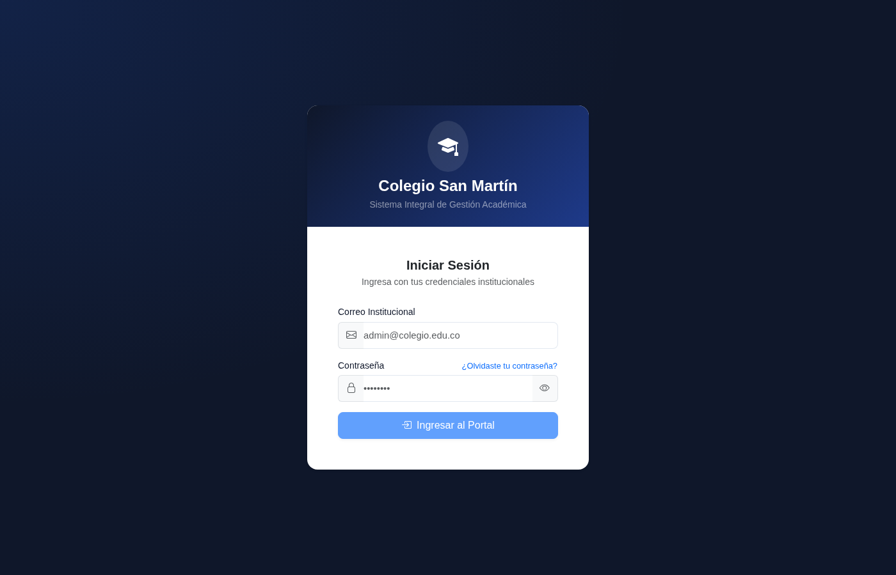

#### Modal de Recuperación de Contraseña
Al hacer clic en *"¿Olvidaste tu contraseña?"*, se despliega una ventana modal donde el docente o estudiante verifica su identidad (`correo_institucional`, `numero_documento` y `fecha_nacimiento`) para restablecer su clave a su documento de identidad.

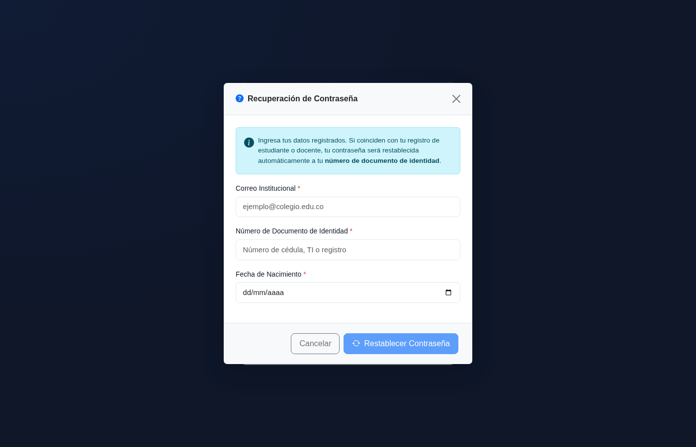

---

### 5.2 Panel de Administración (Rol ADMIN)

#### Dashboard Principal (`/admin/dashboard`)
Presenta un resumen ejecutivo en tiempo real de toda la operación escolar:
- **Tarjetas Métricas**: Total de estudiantes matriculados, docentes activos, asignaturas ofrecidas y salones configurados en el año vigente.
- **Estado de Matrícula y Acciones Rápidas**: Accesos directos para gestionar cursos, docentes, cargas académicas y matrículas.

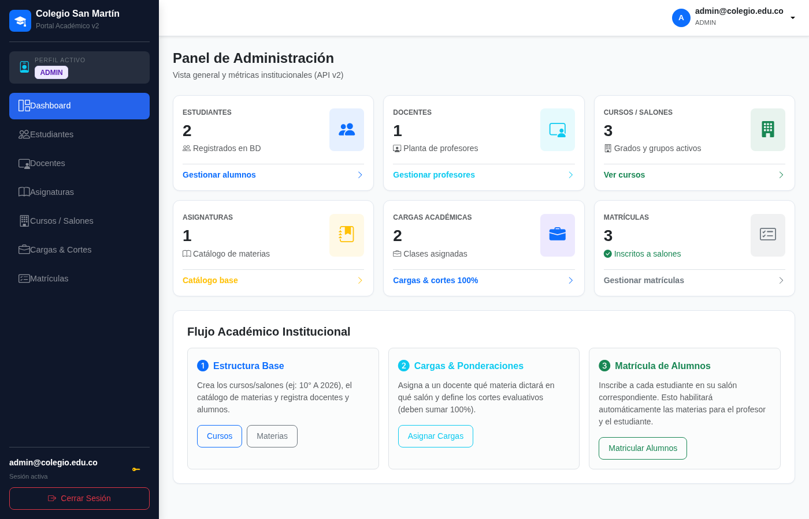

#### Gestión de Estudiantes y Buscador Dinámico (`/admin/estudiantes`)
Permite administrar el directorio completo de estudiantes del colegio:
- **Filtro Instantáneo Indexado**: Busca por documento, nombres, apellidos o correo institucional sin recargar la página.
- **Registro con Autogeneración**: El modal de nuevo estudiante solicita los datos básicos y el sistema genera automáticamente su usuario y correo institucional.

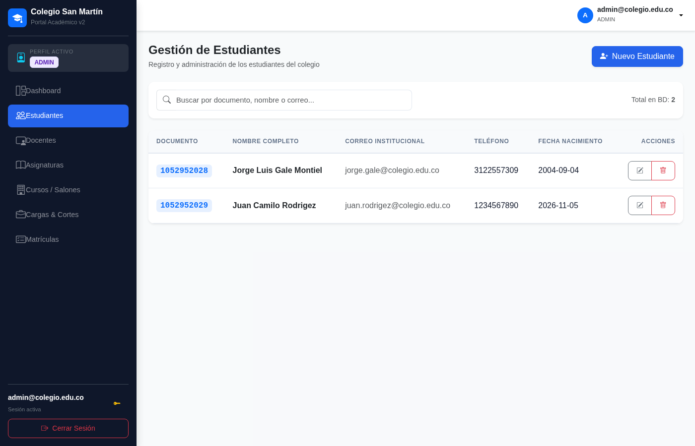

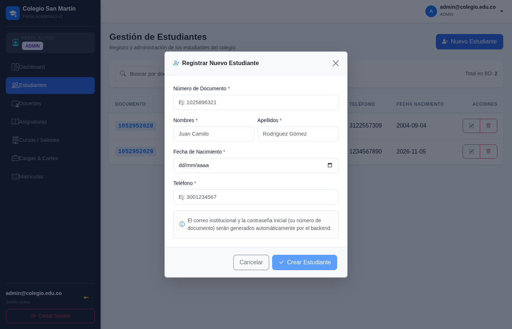

#### Gestión de Docentes (`/admin/docentes`)
Administración de la planta profesoral con protección de integridad referencial (impide eliminar docentes con cargas activas en el año lectivo).

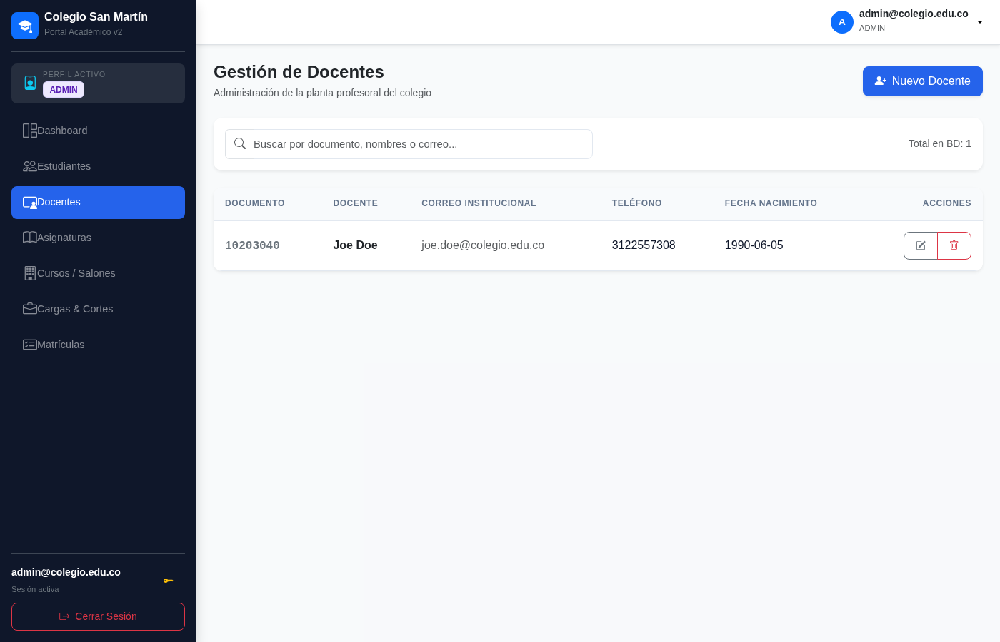

#### Catálogo de Asignaturas (`/admin/asignaturas`)
Administración de las áreas del conocimiento impartidas en la institución que posteriormente se vinculan a los cursos y profesores.

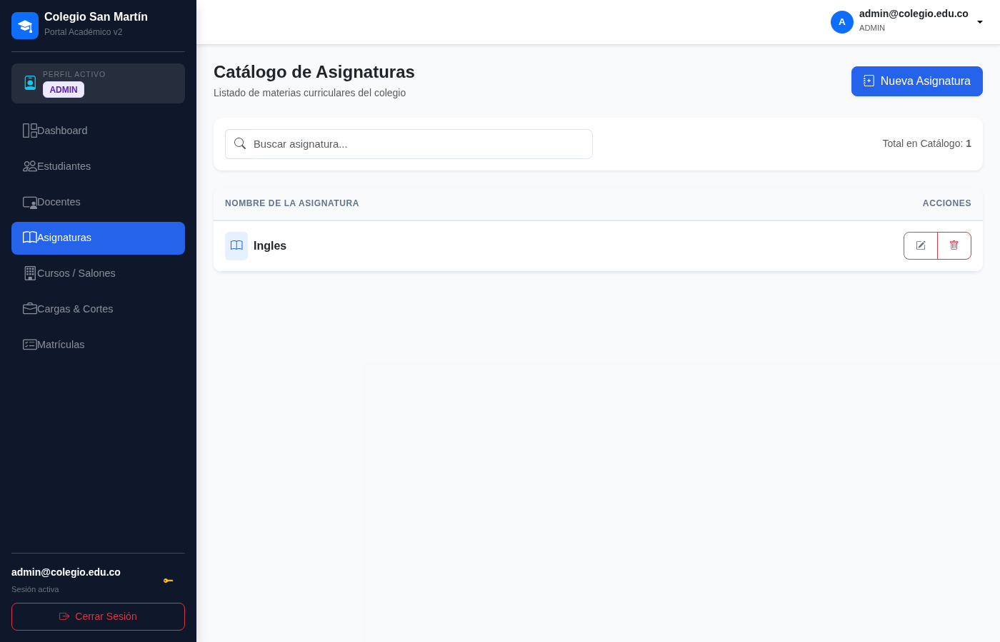

#### Cursos y Salones Académicos (`/admin/cursos`)
Organización de salones escolares por grado y grupo:
- **Diseño Minimalista**: Tarjetas limpias enfocadas en la identificación pedagógica (`11 A`, `10 A`, `1 A`) con icono institucional y botones de acción rápida.
- **Consulta Histórica y Bloqueo de Edición**: Permite consultar qué salones existieron en años anteriores (ej. 2024, 2025) bloqueando su modificación para proteger el historial académico.

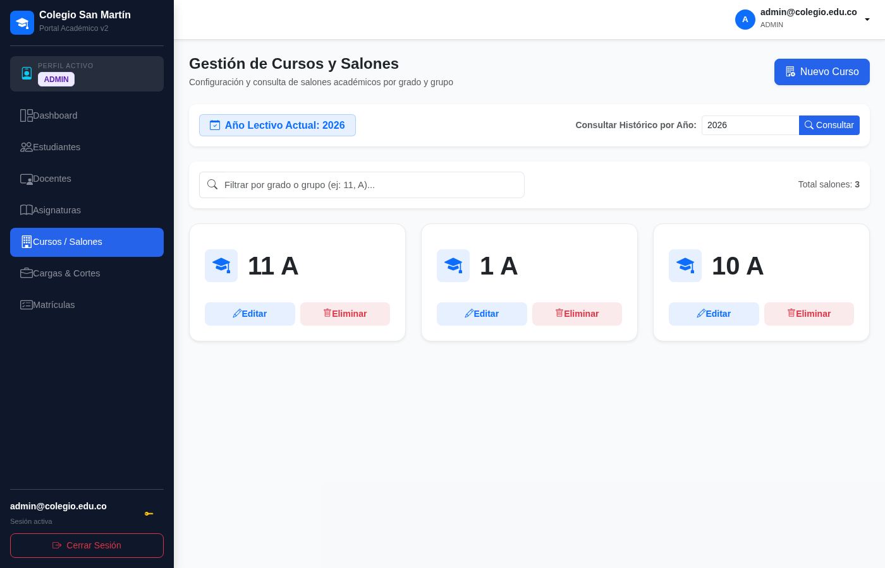

#### Cargas Académicas y Configuración de Cortes Evaluativos (`/admin/cargas-academicas`)
Vincula el Salón + Asignatura + Docente encargado y permite configurar los periodos de evaluación:
- **Regla del 100% con Barra de Progreso**: Valida visualmente que la suma de los cortes sea exactamente 100%.
- **Plantillas Rápidas de 1 Clic**: Configuraciones instantáneas para 3 cortes (30%-30%-40%), 4 cortes (25% c/u) o 2 cortes (50%-50%).
- **Fechas Opcionales (`null`)**: Permite definir las fechas del 1er Periodo y dejar vacías las fechas de periodos futuros hasta que la coordinación académica las programe.

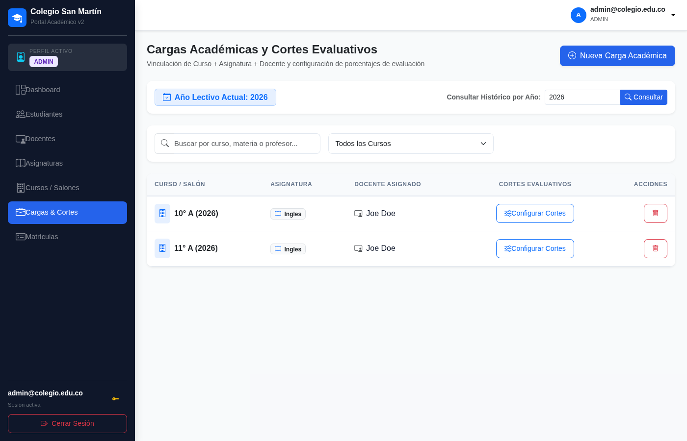

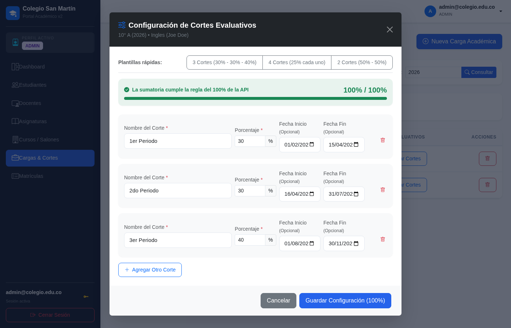

#### Gestión de Matrículas e Inscripción por Salón (`/admin/matriculas`)
Organiza la inscripción de alumnos dentro de cada salón del año vigente:
- **Tarjetas de Salones con Conteo de Inscritos**: Muestra cuántos alumnos tiene cada salón activo.
- **Modal de Matrícula con Buscador Predictivo**: Al seleccionar un salón (ej. `11 A`), permite buscar alumnos por nombre o documento mediante autocompletado (`/api/admin/estudiantes/buscar`) e inscribirlos en un clic.

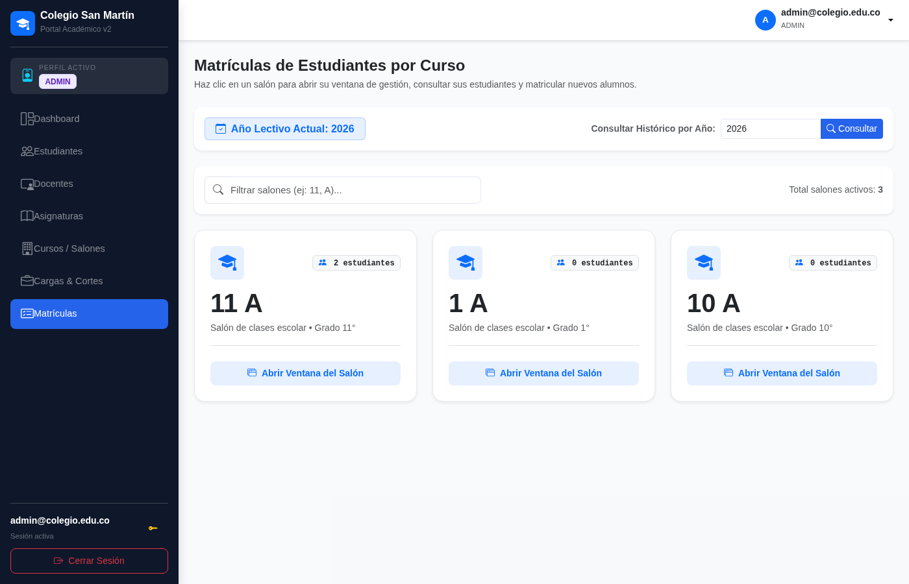

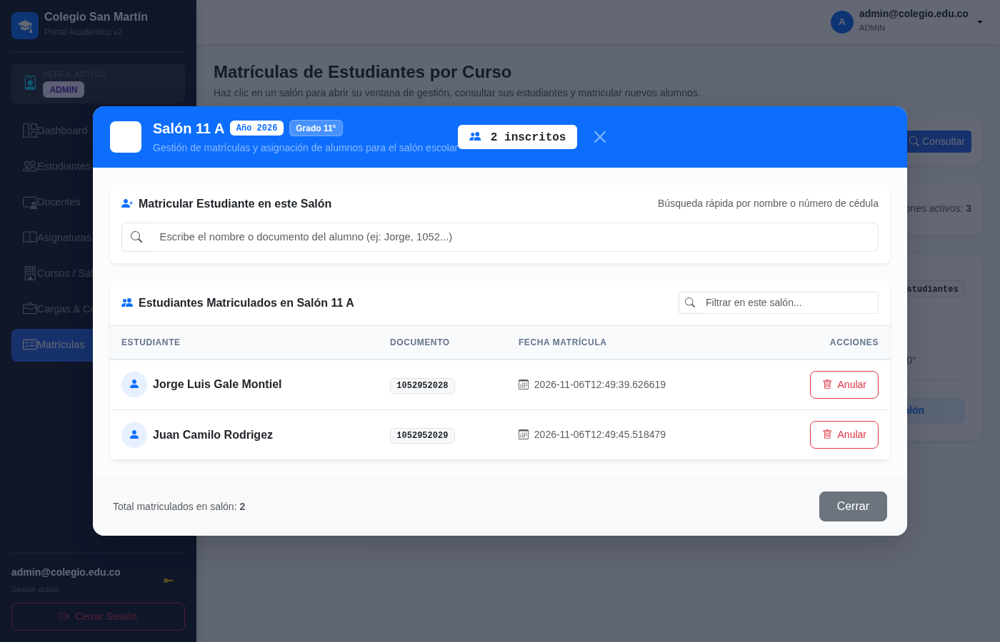

---

### 5.3 Panel del Docente (Rol DOCENTE)

#### Mis Cargas Académicas y Consulta Histórica (`/docente/mis-cargas`)
Muestra al profesor todas las materias y salones que tiene asignados en el año lectivo vigente (2026), además de un buscador para consultar asignaciones de años anteriores.

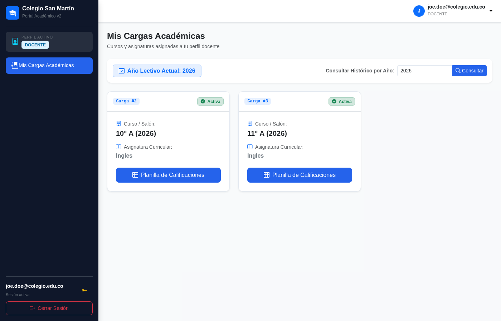

#### Planilla de Calificaciones y Estados Inteligentes de Periodo (`/docente/cargas/:idCarga/calificaciones`)
Permite calificar a los estudiantes matriculados en el salón de la carga académica seleccionada:
- **Cabecera Informativa de Cortes**: Muestra cada periodo con su peso porcentual y ventana de fechas.
- **Estados Inteligentes**:
  -  **Abierto**: La fecha actual se encuentra dentro de la ventana habilitada; permite registrar o editar notas (`0.0` a `5.0`) y observaciones.
  -  **Bloqueado**: La ventana de calificación ya cerró o aún no inicia; muestra las notas registradas en modo lectura.
  - **Sin Fechas**: El administrador aún no ha asignado fechas a ese corte; permanece deshabilitado.

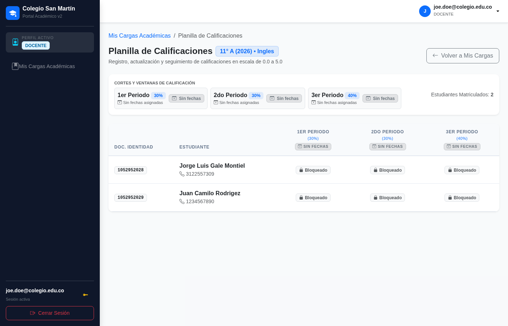

---

### 5.4 Panel del Estudiante (Rol ESTUDIANTE)

#### Boletín Consolidado de Notas y Promedio Ponderado (`/estudiante/mis-notas`)
Ofrece al estudiante y a sus acudientes transparencia total sobre su rendimiento escolar:
- **Indicadores Superiores**: Total de materias en curso, **Promedio Ponderado General** y badge de **Estado Académico** (*Rendimiento Satisfactorio* cuando el promedio es $\ge 3.0$).
- **Diseño Horizontal Compacto**: Cada fila representa una asignatura y muestra sus periodos evaluativos, porcentajes, notas numéricas, observaciones docentes y nota acumulada.
- **Consulta de Boletines Históricos**: Permite consultar las calificaciones definitivas de años anteriores.

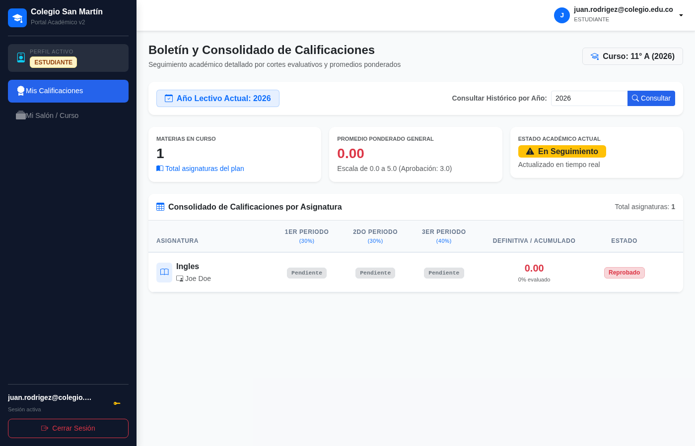

#### Mi Salón y Curso Asignado (`/estudiante/mi-curso`)
Presenta la ficha oficial de matrícula vigente del alumno, indicando su grado, grupo, año escolar y marca temporal exacta de inscripción.

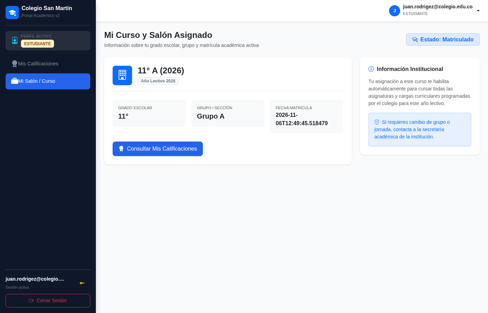

---

## 6. Estructura de Presentación y Sustentación del Proyecto

Para la entrega y sustentación oral de la aplicación ante el docente y los compañeros de la asignatura, se diseñó la siguiente agenda ejecutiva de **10 a 12 minutos**, estructurada para demostrar tanto el dominio técnico como el valor funcional del sistema:

| Bloque | Tiempo Estimado | Contenido Clave a Exponer | Demostración en Vivo / Apoyo Visual |
| :--- | :---: | :--- | :--- |
| **1. Apertura y Problema Local** | 1.5 min | Explicación del problema de gestión académica en el Colegio San Martín (errores en promedios ponderados, descontrol de fechas de digitación de notas y matrículas manuales). | Diagrama del flujo de vida de 6 pasos y objetivos del proyecto. |
| **2. Arquitectura y Estándar ISO/IEC 25010** | 2 min | Explicación del desacoplamiento Frontend (Angular + Bootstrap) ↔ Backend (Spring Boot REST API) ↔ Base de Datos (`db_colegio` en PostgreSQL) y cómo se aplicaron las 8 características de calidad ISO/IEC 25010. | Diagrama de arquitectura en 3 capas y Swagger UI (`http://localhost:8080/swagger-ui.html`). |
| **3. Demo Rol Administrador (`ADMIN`)** | 3 min | Ingreso con `admin@colegio.edu.co`. Recorrido por el Dashboard, alta de un estudiante con autogeneración de correo y clave BCrypt, creación de carga académica, configuración de cortes con barra del 100% y fechas opcionales, y matrícula rápida por salón. | Vistas `/admin/dashboard`, `/admin/estudiantes`, `/admin/cargas-academicas` y `/admin/matriculas`. |
| **4. Demo Rol Docente (`DOCENTE`)** | 2 min | Ingreso con `joe.doe@colegio.edu.co`. Visualización de cargas asignadas y apertura de la planilla de calificaciones. Demostración de cómo el sistema permite calificar en el periodo *Abierto* y protege los periodos  *Bloqueados* o  *Sin Fechas*. | Vistas `/docente/mis-cargas` y `/docente/cargas/:id/calificaciones`. |
| **5. Demo Rol Estudiante (`ESTUDIANTE`)** | 1.5 min | Ingreso con `juan.rodrigez@colegio.edu.co`. Visualización inmediata de la nota recién registrada por el docente en el Boletín Consolidado, cálculo automático del promedio ponderado y consulta de `/estudiante/mi-curso`. | Vistas `/estudiante/mis-notas` y `/estudiante/mi-curso`. |
| **6. Seguridad, Pruebas y Conclusiones** | 1.5 min | Demostración rápida del bloqueo de rutas por rol (Guards + JWT), manejo de errores `422 Unprocessable Entity` e inmutabilidad de años históricos. | Cierre destacando el cumplimiento del 100% de las 4 fases del proyecto. |

---

## 7. Notas Adicionales y Características Especiales del Sistema

Más allá de los requisitos básicos solicitados en la guía de la actividad (CRUD de Estudiantes, Profesores y Calificaciones con autenticación por roles), esta aplicación incorpora **7 características especiales de ingeniería** que elevan su nivel a un sistema real de producción:

1. **Autogeneración Inteligente de Credenciales Institucionales**:
   - Al registrar un estudiante o docente, el sistema normaliza automáticamente sus nombres y apellidos (eliminando tildes y caracteres especiales), verifica homónimos en la base de datos y genera un correo institucional único (`nombre.apellido@colegio.edu.co`), asignando su documento de identidad encriptado con BCrypt como clave inicial.
2. **Cortes Evaluativos Dinámicos con Regla del 100% y Plantillas Rápidas**:
   - En lugar de fijar un número rígido de periodos en el código, cada carga académica puede dividirse en $N$ cortes personalizados siempre que sumen exactamente el **100%**, ofreciendo botones de plantilla rápida (30/30/40, 25/25/25/25, 50/50).
3. **Flexibilidad de Fechas Opcionales (`null`) para Periodos Futuros**:
   - El administrador puede estructurar los porcentajes de todo el año escolar desde el primer día de clases dejando en blanco (`null`) las fechas de los periodos 2 y 3, habilitándolas progresivamente a medida que avanza el calendario escolar.
4. **Control Automático de Ventanas de Calificación por Fecha**:
   - El servidor valida en tiempo real (`LocalDate.now()`) que ningún docente pueda insertar o alterar calificaciones fuera del rango `[fecha_inicio_calificacion, fecha_fin_calificacion]` definido por la administración.
5. **Inmutabilidad y Auditoría Histórica Multi-Año (`/historial/.../{anio}`)**:
   - Tanto el Administrador como el Docente y el Estudiante disponen de consultores históricos por año lectivo (ej. 2024, 2025), mientras el backend impide mediante reglas `422 Unprocessable Entity` que se editen cursos o registros de años cerrados.
6. **Buscador Predictivo de Alto Rendimiento para Matrículas**:
   - Endpoint dedicado `/api/admin/estudiantes/buscar` con límite paginado que permite buscar entre miles de alumnos en milisegundos al momento de conformar los salones.
7. **Autoservicio de Recuperación y Cambio de Contraseña**:
   - Validación cruzada de identidad (`correo_institucional` + `numero_documento` + `fecha_nacimiento`) para restablecer contraseñas sin requerir soporte manual del administrador.

---

## 8. Anexo Técnico: Referencia Completa de Endpoints de la API REST

| Método HTTP | Endpoint | Rol Requerido | Descripción Funcional |
| :---: | :--- | :---: | :--- |
| `POST` | `/api/auth/login` | Público | Autentica al usuario y retorna el token JWT (`Bearer`), rol e ID. |
| `POST` | `/api/auth/recuperar-password` | Público | Restablece la contraseña al número de documento tras validar identidad. |
| `PUT` | `/api/cuenta/cambiar-password` | Autenticado | Cambia la contraseña actual del usuario logueado por una nueva. |
| `GET` | `/api/admin/estudiantes` | `ADMIN` | Lista estudiantes con soporte de búsqueda (`search`) y límite (`limit`). |
| `GET` | `/api/admin/estudiantes/buscar` | `ADMIN` | Autocompletado rápido de estudiantes (`q`, `limit`) para matrículas. |
| `POST` | `/api/admin/estudiantes` | `ADMIN` | Crea estudiante, autogenera correo institucional y usuario con clave BCrypt. |
| `PUT` | `/api/admin/estudiantes/{id}` | `ADMIN` | Actualiza datos personales del estudiante. |
| `DELETE` | `/api/admin/estudiantes/{id}` | `ADMIN` | Elimina al estudiante y su usuario en cascada. |
| `GET/POST/PUT/DELETE` | `/api/admin/docentes` | `ADMIN` | CRUD completo de docentes con protección contra borrado si tiene cargas. |
| `GET/POST/PUT/DELETE` | `/api/admin/asignaturas` | `ADMIN` | CRUD del catálogo general de asignaturas. |
| `GET/POST/PUT/DELETE` | `/api/admin/cursos` | `ADMIN` | CRUD de cursos del año actual. Bloquea edición de años anteriores (`422`). |
| `GET` | `/api/admin/historial/cursos/{anio}` | `ADMIN` | Consulta histórica de salones de un año lectivo específico. |
| `GET/POST/DELETE` | `/api/admin/cargas-academicas` | `ADMIN` | Gestión de asignaciones Curso + Asignatura + Docente del año actual. |
| `GET` | `/api/admin/historial/cargas-academicas/{anio}` | `ADMIN` | Consulta histórica de cargas académicas de años anteriores. |
| `GET/POST` | `/api/admin/cargas-academicas/{id}/cortes` | `ADMIN` | Configura o consulta cortes evaluativos (suma 100%, fechas opcionales). |
| `GET/POST/DELETE` | `/api/admin/matriculas` | `ADMIN` | Inscripción y gestión de matrículas de alumnos en salones activos. |
| `GET` | `/api/admin/historial/matriculas/{anio}` | `ADMIN` | Consulta histórica de matrículas por año lectivo. |
| `GET` | `/api/docente/mis-cargas` | `DOCENTE` | Lista las materias y cursos asignados al docente logueado en el año actual. |
| `GET` | `/api/docente/historial/mis-cargas/{anio}` | `DOCENTE` | Lista las cargas académicas que el docente dictó en un año anterior. |
| `GET` | `/api/docente/cargas/{id}/estudiantes` | `DOCENTE` | Lista los alumnos matriculados en el salón de la carga (valida titularidad). |
| `GET` | `/api/docente/cargas/{id}/cortes` | `DOCENTE` | Obtiene los cortes y ventanas de fechas de la carga académica. |
| `GET` | `/api/docente/cargas/{id}/calificaciones` | `DOCENTE` | Obtiene las notas previamente registradas en la planilla de esa carga. |
| `POST` | `/api/docente/calificaciones` | `DOCENTE` | Registra o actualiza (`upsert`) una nota (0.0 a 5.0) si el corte está abierto. |
| `GET` | `/api/estudiante/mi-curso` | `ESTUDIANTE` | Muestra el salón (grado, grupo, año y fecha de matrícula) del alumno. |
| `GET` | `/api/estudiante/mis-notas` | `ESTUDIANTE` | Genera el boletín consolidado del año actual con promedio ponderado. |
| `GET` | `/api/estudiante/historial/mis-notas/{anio}` | `ESTUDIANTE` | Genera el boletín histórico del estudiante para el año consultado. |
