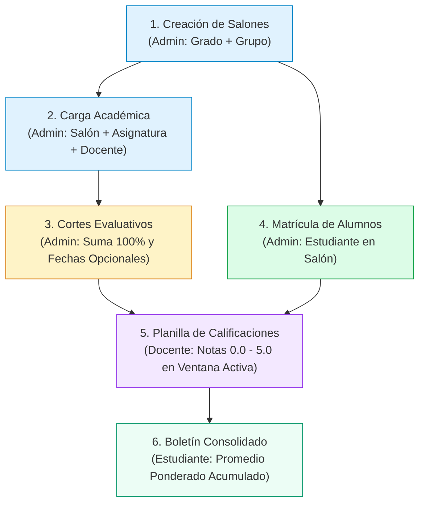

# 🎓 Manual Integral de Usuario y Documentación de Paneles
## Sistema de Gestión Académica — Colegio San Martín (Portal Académico v2)

Este manual documenta de forma completa, visual y estructurada todas las funcionalidades, flujos operativos, paneles y reglas de negocio del sistema web del **Colegio San Martín**, abarcando desde el inicio de sesión hasta la consulta consolidada de notas finales para cada uno de los roles: **Administrador**, **Docente** y **Estudiante**.

---

## 📑 Tabla de Contenidos

1. [Credenciales de Demostración y Acceso](#1-credenciales-de-demostración-y-acceso)
2. [Arquitectura y Flujo de Vida del Sistema](#2-arquitectura-y-flujo-de-vida-del-sistema)
3. [Módulo de Autenticación y Seguridad](#3-módulo-de-autenticación-y-seguridad)
4. [Panel de Administración (ADMIN)](#4-panel-de-administración-admin)
   - 4.1 [Dashboard Principal](#41-dashboard-principal)
   - 4.2 [Gestión de Estudiantes y Autocompletado](#42-gestión-de-estudiantes-y-autocompletado)
   - 4.3 [Gestión de Docentes](#43-gestión-de-docentes)
   - 4.4 [Gestión de Asignaturas](#44-gestión-de-asignaturas)
   - 4.5 [Cursos y Salones Académicos](#45-cursos-y-salones-académicos)
   - 4.6 [Cargas Académicas y Configuración de Cortes Evaluativos](#46-cargas-académicas-y-configuración-de-cortes-evaluativos)
   - 4.7 [Gestión de Matrículas e Inscripción por Salón](#47-gestión-de-matrículas-e-inscripción-por-salón)
5. [Panel del Docente (DOCENTE)](#5-panel-del-docente-docente)
   - 5.1 [Mis Cargas Académicas y Consulta Histórica](#51-mis-cargas-académicas-y-consulta-histórica)
   - 5.2 [Planilla de Calificaciones y Estados de Periodo](#52-planilla-de-calificaciones-y-estados-de-periodo)
6. [Panel del Estudiante (ESTUDIANTE)](#6-panel-del-estudiante-estudiante)
   - 6.1 [Boletín Consolidado de Notas y Promedio Ponderado](#61-boletín-consolidado-de-notas-y-promedio-ponderado)
   - 6.2 [Mi Salón y Curso Asignado](#62-mi-salón-y-curso-asignado)
7. [Matriz de Roles, Rutas y Permisos](#7-matriz-de-roles-rutas-y-permisos)

---

## 1. Credenciales de Demostración y Acceso

El sistema cuenta con control de acceso basado en roles (RBAC) y tokens JWT. Para explorar los diferentes perfiles del sistema:

| Rol | Correo Institucional | Contraseña | Panel Inicial por Defecto |
| :--- | :--- | :--- | :--- |
| **Administrador** | `admin@colegio.edu.co` | `admin123` | `/admin/dashboard` |
| **Docente** | `joe.doe@colegio.edu.co` | `10203040` | `/docente/mis-cargas` |
| **Estudiante** | `juan.rodrigez@colegio.edu.co` | `1052952029` | `/estudiante/mis-notas` |

> [!NOTE]
> Las contraseñas de docentes y estudiantes corresponden por defecto a su número de documento de identidad para facilitar la incorporación inicial al portal.

---

## 2. Arquitectura y Flujo de Vida del Sistema

El siguiente diagrama ilustra el flujo operativo de datos dentro de la plataforma desde que el administrador inicializa el ciclo escolar hasta que el estudiante visualiza su boletín:

---

## 3. Módulo de Autenticación y Seguridad

### 3.1 Inicio de Sesión (`/login`)
El acceso al sistema se realiza a través de una interfaz institucional limpia y responsiva.
- **Validaciones**: Se comprueba que el formato del correo institucional sea válido y que la contraseña no esté vacía.
- **Seguridad**: Al enviar las credenciales, el backend valida el hash BCrypt y genera un token JWT con vigencia temporal.
- **Redirección Inteligente**: El servicio de autenticación lee los *claims* del token y redirige de manera automática al panel correspondiente según el rol del usuario.

### 3.2 Recuperación de Contraseña
Haciendo clic en el enlace *"¿Olvidaste tu contraseña?"*, se despliega una ventana modal donde el usuario introduce su correo institucional para recibir las instrucciones de restablecimiento de clave.

---

## 4. Panel de Administración (ADMIN)

El administrador tiene control total sobre el ciclo lectivo, usuarios, materias, cargas de trabajo y estructura académica.

### 4.1 Dashboard Principal (`/admin/dashboard`)
Presenta un resumen ejecutivo en tiempo real de la operación escolar:
- **Tarjetas Métricas**: Cantidad de estudiantes matriculados, número de profesores activos, asignaturas ofrecidas y salones configurados.
- **Estado de Matrícula**: Porcentaje de ocupación escolar y seguimiento del año lectivo vigente.
- **Acciones Rápidas**: Enlaces directos para crear cursos, registrar docentes o asignar cargas.

---

### 4.2 Gestión de Estudiantes y Autocompletado (`/admin/estudiantes`)
Permite administrar la base de datos de alumnos del colegio.
- **Búsqueda Instantánea**: Filtro dinámico indexado capaz de buscar por número de documento, nombres, apellidos o correo electrónico sin congelar la interfaz.
- **Alta de Nuevo Estudiante**: Modal con validaciones estrictas para tipo de documento (CC, TI, CE), número de identificación único, nombres, teléfono de contacto y correo institucional.
- **Edición y Eliminación**: Control de edición y eliminación segura con confirmación.

---

### 4.3 Gestión de Docentes (`/admin/docentes`)
Administración de la planta profesoral del colegio.
- **Directorio de Profesores**: Visualización de especialidad académica (ej: Lenguas Extranjeras, Matemáticas, Ciencias), correo y teléfono.
- **Protección de Integridad Referencial**: El sistema impide eliminar a un docente si este tiene materias o cargas académicas asignadas en el año lectivo en curso (`422 Unprocessable Entity`).

---

### 4.4 Gestión de Asignaturas (`/admin/asignaturas`)
Catálogo de áreas del conocimiento impartidas en la institución.
- **Campos**: Código interno, nombre de la asignatura, intensidad horaria semanal y descripción pedagógica.
- **Uso en Cargas**: Estas materias son las que posteriormente se vinculan a los docentes y salones.

---

### 4.5 Cursos y Salones Académicos (`/admin/cursos`)
Gestión y organización de salones escolares por grado y grupo (ej: `11 A`, `10 A`).
- **Diseño Limpio**: Presenta los cursos en tarjetas intuitivas sin mostrar identificadores de base de datos (`id`), enfocándose en el nombre pedagógico (`10° A`, `11° A`).
- **Bloqueo de Edición Histórica**: Los cursos de años anteriores al año actual no se pueden editar para preservar la integridad del historial académico.
- **Buscador de Historial por Año**: Permite consultar qué salones existieron en años pasados (ej: 2024, 2025) con un solo clic.

---

### 4.6 Cargas Académicas y Configuración de Cortes Evaluativos (`/admin/cargas-academicas`)
Vínculo entre el Curso, la Asignatura y el Docente encargado.

- **Filtrado por Año Lectivo**: Muestra únicamente las cargas del año en curso (2026) y cuenta con selector de historial para años previos.
- **Configuración de Cortes Evaluativos**:
  - **Regla del 100%**: Los porcentajes de los cortes deben sumar exactamente el 100% (validado en tiempo real con barra de progreso verde).
  - **Plantillas Rápidas**: Accesos rápidos de un clic para configuraciones comunes (3 cortes 30%-30%-40%, 4 cortes 25% cada uno, 2 cortes 50%-50%).
  - **Fechas Opcionales**: Las fechas de inicio y fin de calificación pueden guardarse en blanco (`null`), permitiendo guardar la estructura general del año sin forzar las fechas de los periodos 2 y 3 por adelantado.
  - **Validación Cronológica**: Si se ingresan fechas, `fecha_inicio` no puede ser posterior a `fecha_fin`.

---

### 4.7 Gestión de Matrículas e Inscripción por Salón (`/admin/matriculas`)
Organización de los estudiantes en sus salones correspondientes.

- **Cajitas de Salones Activos**: La vista principal muestra exclusivamente las tarjetas de los cursos del año lectivo vigente con el conteo de estudiantes inscritos.
- **Ventana Modal de Salón**: Al hacer clic en un salón (ej: `11 A`), se abre una ventana modal dedicada para gestionar las matrículas de ese salón específico.
- **Búsqueda Dinámica**: Cuenta con un buscador predictivo que consulta el endpoint `/api/admin/estudiantes/buscar` para localizar estudiantes por nombre o documento y matricularlos en un solo clic.

---

## 5. Panel del Docente (DOCENTE)

El docente dispone de una interfaz optimizada para gestionar sus materias asignadas y registrar las notas de sus alumnos respetando los periodos activos.

### 5.1 Mis Cargas Académicas y Consulta Histórica (`/docente/mis-cargas`)
- Muestra el listado de materias y salones que el docente tiene a su cargo durante el año actual.
- Cuenta con un botón *"Ver Planilla de Calificaciones"* para acceder a la gestión de notas.
- Incluye el módulo de consulta histórica para revisar asignaciones de años anteriores.

---

### 5.2 Planilla de Calificaciones y Estados de Periodo (`/docente/cargas/:idCarga/calificaciones`)
Permite calificar a todos los estudiantes inscritos en la materia.

- **Resumen de Cortes en Cabecera**: Tarjetas informativas con el nombre del corte, porcentaje y rango de fechas.
- **Estados Inteligentes de Periodo**:
  - 🟢 **Abierto**: El periodo tiene fechas asignadas y la fecha actual se encuentra dentro del rango. El docente puede asignar o editar notas.
  - 🔒 **Bloqueado**: La ventana de tiempo caducó o el periodo aún no inicia. Si ya existen notas registradas, se muestran en pantalla pero los controles de edición quedan protegidos.
  - ⚪ **Sin Fechas**: El corte aún no tiene fechas definidas por el administrador; se mantiene deshabilitado.
- **Registro de Notas (0.0 a 5.0)**: Modal interactivo para ingresar la calificación con validación de escala decimal y observaciones cualitativas.

---

## 6. Panel del Estudiante (ESTUDIANTE)

Diseñado con un enfoque centrado en la transparencia académica, permitiendo al alumno y a sus acudientes hacer seguimiento continuo a su progreso escolar.

### 6.1 Boletín Consolidado de Notas y Promedio Ponderado (`/estudiante/mis-notas`)
- **Indicadores Clave**:
  - **Materias en curso**: Total de asignaturas cursadas en el ciclo lectivo.
  - **Promedio Ponderado General**: Calculado dinámicamente según los porcentajes evaluados hasta el momento.
  - **Estado Académico**: Badge de estado (*Rendimiento Satisfactorio* si $\ge 3.0$, o alerta preventiva si $< 3.0$).
- **Diseño Horizontal Compacto**: Todas las notas se muestran en una sola fila por asignatura, agrupando en columnas los cortes evaluativos (1er Periodo, 2do Periodo, 3er Periodo), ponderaciones, notas numéricas y observaciones docentes.
- **Consulta de Boletines Históricos**: Permite ingresar un año previo (ej: 2025) y consultar las notas definitivas de años escolares anteriores.

---

### 6.2 Mi Salón y Curso Asignado (`/estudiante/mi-curso`)
Muestra la ficha de matrícula oficial del estudiante para el ciclo lectivo en curso:
- Grado académico (ej: Grado 11°).
- Grupo asignado (ej: Grupo A).
- Año escolar vigente (2026).
- Fecha y hora exacta en la que se formalizó la matrícula.

---

## 7. Matriz de Roles, Rutas y Permisos

| Módulo / Función | Ruta Angular Frontend | Endpoint Backend | Rol ADMIN | Rol DOCENTE | Rol ESTUDIANTE |
| :--- | :--- | :--- | :---: | :---: | :---: |
| **Inicio de Sesión** | `/login` | `POST /api/auth/login` | ✅ | ✅ | ✅ |
| **Dashboard** | `/admin/dashboard` | `GET /api/admin/dashboard` | ✅ | ❌ | ❌ |
| **Estudiantes** | `/admin/estudiantes` | `GET /api/admin/estudiantes` | ✅ | ❌ | ❌ |
| **Autocompletado Alumnos** | *(Modal Matrículas)* | `GET /api/admin/estudiantes/buscar` | ✅ | ❌ | ❌ |
| **Docentes** | `/admin/docentes` | `GET /api/admin/docentes` | ✅ | ❌ | ❌ |
| **Asignaturas** | `/admin/asignaturas` | `GET /api/admin/asignaturas` | ✅ | ❌ | ❌ |
| **Cursos y Salones** | `/admin/cursos` | `GET /api/admin/cursos` | ✅ | ❌ | ❌ |
| **Cursos Históricos** | `/admin/cursos` | `GET /api/admin/historial/cursos/{anio}` | ✅ | ❌ | ❌ |
| **Cargas Académicas** | `/admin/cargas-academicas` | `GET /api/admin/cargas-academicas` | ✅ | ❌ | ❌ |
| **Configurar Cortes** | `/admin/cargas-academicas` | `POST /api/admin/cargas-academicas/{id}/cortes` | ✅ | ❌ | ❌ |
| **Matrículas** | `/admin/matriculas` | `GET /api/admin/matriculas` | ✅ | ❌ | ❌ |
| **Mis Cargas Docente** | `/docente/mis-cargas` | `GET /api/docente/mis-cargas` | ❌ | ✅ | ❌ |
| **Planilla Notas** | `/docente/cargas/:id/calificaciones` | `GET/POST /api/docente/calificaciones` | ❌ | ✅ | ❌ |
| **Boletín de Notas** | `/estudiante/mis-notas` | `GET /api/estudiante/mis-notas` | ❌ | ❌ | ✅ |
| **Boletín Histórico** | `/estudiante/mis-notas` | `GET /api/estudiante/historial/mis-notas/{anio}` | ❌ | ❌ | ✅ |
| **Ficha de Matrícula** | `/estudiante/mi-curso` | `GET /api/estudiante/mi-curso` | ❌ | ❌ | ✅ |
